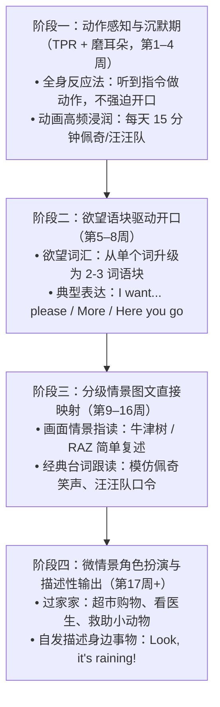

# 幼儿英语自然习得规划 (4–5岁中班)
## —— 结合原版动画（小猪佩奇、汪汪队）与生活情境的零抗拒启蒙路线图

> **编者按**：本规划专为 4–5 岁（幼儿园中班）儿童设计，基于应用语言学之父斯蒂芬·克拉申（Stephen Krashen）的“二语习得理论（SLA）”、阿谢尔（James Asher）的“全身反应法（TPR）”以及现代儿童发展心理学编写。目标是让孩子**不抗拒、有浓厚兴趣、自然建立英语思维，达到在生活情境中自发说出完整句子**的水平。

---

## 一、 核心痛点与底层逻辑剖析

### 1. 为什么同龄孩子在实验幼儿园/双语班能“脱口而出”？
很多家长以为名校孩子靠的是“记单词卡”或“抢跑学拼写”。其实恰恰相反：
- **错误方式**：传统死记硬背名词标签（*Apple、Tiger、Yellow*），脑海中必须走“中文概念 $\to$ 翻译中介 $\to$ 英文发音”的迂回链路，导致孩子只能结结巴巴蹦单词，甚至因“被考核”而产生强烈的逆反心理。
- **实验幼儿园的科学路径**：直接建立**「生活情境 / 视觉画面 $\Longleftrightarrow$ 声音语块（Sound Chunks）」**的直连通路，跳过中文翻译。
  - 例如：看到好吃的直接说 *"Yummy! Can I have some?"*，而不是先在大脑里想“好吃”怎么说再造句。

### 2. 4–5 岁幼儿语言发展的生理与心理优势
1. **语音敏感期峰值**：辨音神经元最为敏锐，听原版音频能轻松习得地道连读与弱读（如 *Let it go*、*Here you go*）；
2. **形象思维为主**：只对“好玩的、好吃的、自己关心的、角色扮演的”事物感兴趣；
3. **极度排斥考核，渴求情绪认同**：一旦家长问出“这个用英语怎么说？”，孩子就会进入防御心理；而一旦换成过家家或模仿佩奇跳泥坑，孩子会抢着表演。

---

## 二、 4 步无痛进阶路线图（从 0 到自主整句表达）

### 阶段一：动作感知与沉默期（TPR + 磨耳朵，第 1–4 周）
- **核心法则**：**只听、只做动作，绝对不强求开口**。尊重幼儿 1~3 个月的“语言沉默期（Silent Period）”。
- **家庭实操（全身反应法 TPR）**：家长在日常固定动作时，使用简短英文指令并做出夸张动作：
  1. 穿鞋出门：`"Put on your shoes! Let's go!"`（指着鞋子，做穿鞋手势）
  2. 饭前洗手：`"Let's wash hands! Rub, rub, rub."`（模仿搓手动作）
  3. 递给物品：`"Here you go."`（双手递物）
  4. 睡觉晚安：`"Time for bed! Sweet dreams!"`（做出枕头睡觉手势）
- **原版儿歌精听**：
  - 首选《Super Simple Songs》(SSS)：*Walking Walking*, *Open Shut Them*, *Make a Circle*；
  - 边听边跟孩子做相同的肢体律动。

### 阶段二：欲望语块驱动开口（从 1 个字升级为整句，第 5–8 周）
- **核心法则**：利用孩子**“最想要满足的需求”**作为开口的第一驱动力。
- **语块升级阶梯**：
  - 渴了想喝水：原来只会喊 `"水"` $\to$ 升级为 `"Water, please!"` $\to$ 引导完整表达：`"I want some water, please!"`
  - 还要吃零食：`"More, please!"`
  - 收到礼物/零食：`"Thank you so much!"`
  - 捉迷藏找人：`"Where are you?"` $\to$ 找到时欢呼：`"Here I am!"`
- **二选一无痛引导**：
  - 家长手拿苹果和香蕉问：`"Do you want an apple, or a banana?"`
  - 孩子自然模仿说出：`"An apple, please!"`（比直接逼问“说整句”顺畅自然）。

### 阶段三：原版动画情境渗透（小猪佩奇 & 汪汪队，第 9–16 周）
孩子最崇拜的偶像是动画片里的英雄和萌宠。把经典台词融入生活，孩子会兴奋地自发复现：

#### 🐷 小猪佩奇（Peppa Pig）生活场景化借力：
1. **下雨天踩水坑**：
   - 佩奇名场面：`"I love muddy puddles!"`
   - 家长带孩子跳垫子/跳水坑时喊：`"Jump up and down! Splish, splash, splosh!"`
2. **弟弟乔治的恐龙玩具**：
   - 拿玩具玩恐龙大战时喊：`"Dinosaur! Grrr!"`
3. **晚餐想吃什么**：
   - 家长问：`"What do you want for dinner?"`
   - 孩子模仿佩奇回答：`"Spaghetti, please!"` / `"Pizza, please!"`
4. **开心大笑的仪式感**：
   - 佩奇经典的倒地大笑：`"Snort, snort! That's so funny!"`

#### 🐾 汪汪队立大功（PAW Patrol）救援与勇敢借力：
1. **呼唤与集结（解决生活中的小困难）**：
   - 积木倒了或东西拿不到时，家长喊：`"PAW Patrol, to the Lookout!"`
   - 孩子回应：`"PAW Patrol is on a roll!"`
2. **阿奇探长（勇敢担当）**：
   - 自己穿好衣服或找到玩具时自豪地说：`"Chase is on the case!"`
3. **毛毛消防犬（热情与互助）**：
   - 准备冲锋去公园时：`"I'm fired up! Ready for a ruff-ruff rescue!"`
4. **团队精神与自信建立**：
   - 口号伴随日常：`"No job is too big, no pup is too small!"`
   - 获得帮助时表达感谢：`"Thank you, pups!"` $\to$ `"You're welcome!"`

### 阶段四：微情景角色扮演与自发描述（第 17 周以后）
- **过家家游戏（Role-play）**：
  - 超市老板与顾客：
    - 家长：`"Hello! What do you want?"`
    - 孩子：`"I want two bananas and one apple, please."`
    - 家长：`"Here you go! That's five dollars."`
    - 孩子：`"Thank you! Goodbye!"`
- **自然观察与感官描述**：
  - 看到窗外下大雨：`"Look! It's raining outside!"`
  - 看到大汽车：`"Wow, look at that big red bus!"`
  - 吃到甜草莓：`"Mmm, it's so sweet and yummy!"`

---

## 三、 家长务必牢记的 4 大黄金心法

1. **绝对杜绝“随堂抽测式”中英互译**：
   - ❌ 致命错误：走在路上突然指着花问：“花用英语怎么说？快跟阿姨说一个！”（会让孩子产生被考核的羞耻感与紧张感）。
   -  正确引导：家长自然地赞美：“*Wow, what a beautiful flower! Look, it's pink!*”，让孩子沉浸在真实交流的情境中。
2. **使用“三明治表达法”自然过渡**：
   - 当孩子初学时，可用少量中文做桥梁：*“宝贝，把你的 shoes 穿上，let's go 咯！”*
   - 一两周后孩子听懂了动作，直接切换成纯正指令：*“Put on your shoes, let's go!”*
3. **把英语与“最快乐、最温馨的时刻”绑定**：
   - 每天 10~15 分钟的小猪佩奇或汪汪队原版英文动画，是孩子一天最期待的放松时光；
   - 亲子英语互动不是严肃的上课，而是“爸爸妈妈在跟我玩恐龙救援游戏”。
4. **坚决接纳孩子的“不完美”与静待花开**：
   - 孩子说出单个词或发音不完全准确时，**绝对不要当场批评或打断纠正**；
   - 家长只需用正确的句子温和重复一遍反馈即可（例如孩子说 *"Cat, run!"*，家长回应 *"Yes! The cat is running so fast!"*）。

---

## 四、 《中班学习乐园》平台落地配套体系

为了让普通家庭家长即使英文不熟练，也能轻松带孩子零门槛启蒙，平台提供三大数字化支撑：
1. **全新情景化题库（`data_eng.js`）**：
   - 引入《小猪佩奇》与《汪汪队》经典原声台词互动；
   - 引入生活高频需求语块（*I want... / Here you go / Put on your shoes*）；
   - 引入超市与角色扮演微情景；
2. **微软高保真原生美音离线伴读**：
   - 题目、选项与详细口语讲解全量配套高保真 MP3（100% 离线支持）；
3. **A4 家长日常口语小抄（一键打印）**：
   - 在平台家长专区提供一键打印 A4 纸质卡片，贴在冰箱或玄关，家长随时对照脱口而出！
