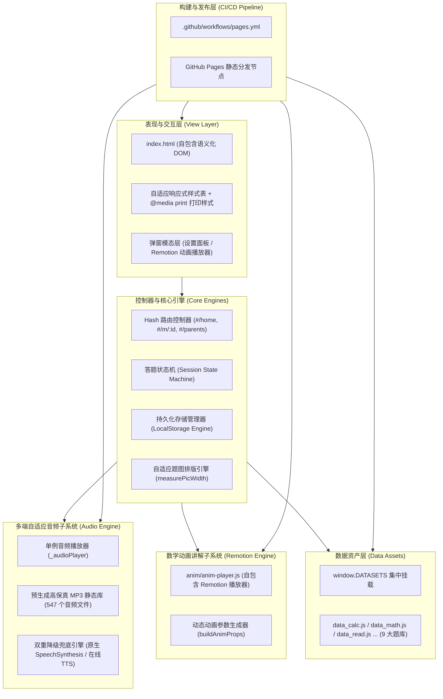
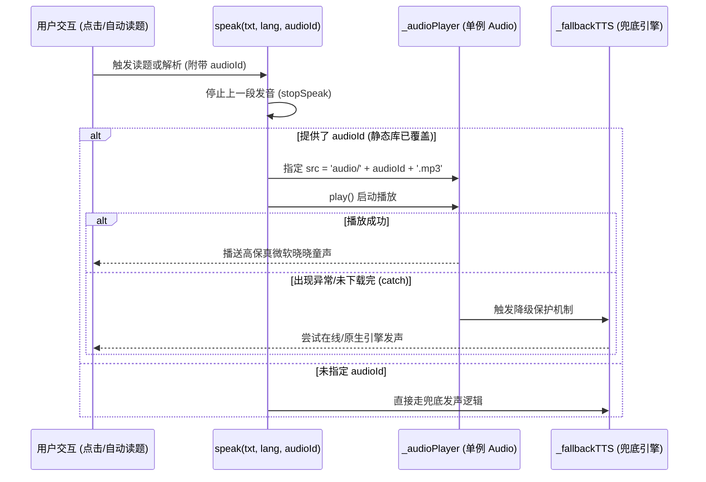

# 中班学习乐园 — 总体架构设计说明书 (SSOT)

> **定位**：本文档为《中班学习乐园》项目唯一权威技术架构真相源（Single Source of Truth），系统阐述项目的设计哲学、技术分层、数据契约、核心子系统实现原理及构建部署流程。

---

## 1. 项目定位与设计哲学

《中班学习乐园》（`zhongban-learning`）是专为 4–5 岁幼儿园中班小朋友及其家长设计的家庭作业与启蒙辅导 Web 互动应用。

### 核心设计哲学
1. **纯静态零后端依赖（Zero Backend Dependency）**：全站无任何服务端 API，无需数据库，解压后双击 `index.html` 即可完整运行；
2. **100% 离线可用（Full Offline Capability）**：字体、图标、动画、核心音频均离线内置，在无网络环境（如外出平板、U盘给长辈使用）下功能完全无损；
3. **极简轻量，秒开体验（Instant Startup）**：采用原生 Vanilla JavaScript + 原生 CSS，首屏无需加载数百 KB 的大型框架 Runtime；
4. **多端极致兼容（Cross-Platform & WeChat Friendly）**：适配桌面端、平板、手机，并对微信内置浏览器（Android XWeb / iOS WKWebView）进行全面兼容优化。

---

## 2. 总体架构分层

项目在架构上划分为清晰的五层结构：



---

## 3. 数据模型规范与标准契约

项目所有题库数据采用声明式设计，挂载在全局 `window.DATASETS` 数组中。

### 3.1 题库数据集契约 (`Dataset`)
```javascript
{
  id: 'read',               // 模块唯一标识 (路由参数)
  name: '识字乐园',          // 模块完整展示名
  short: '识字',            // 导航栏短标签
  icon: '📖',               // 模块 Emoji 图标
  color: '#f97316',         // 模块主题色 (CSS 动态染色)
  desc: '看图认字...',       // 家长指导与模块介绍
  layout: 'standard',       // 布局模式：standard (默认答题卡) 或 song (古诗儿歌卡)
  sets: [ ... ]             // 题组列表 (Set[])
}
```

### 3.2 题组契约 (`Set`) 与题目契约 (`Question`)
```javascript
// 题组
{
  em: '👨‍👩‍👧‍👦',              // 题组图标
  name: '我爱我家（家人）',    // 题组名称
  qs: [ ... ]               // 题目列表
}

// 标准练习题目契约 (Question)
{
  pic: '👨',                // 题目配图：Emoji、SVG 矢量源码、或 HTML 片段
  q: '这是谁呀？...',        // 题目主干文字（读题朗读内容）
  h: '想一想...',           // 引导提示语 (家长提示 / 思考方向)
  opts: ['爸', '妈', '爷'], // 选项数组 (字符串或带有 <svg> 的图元)
  a: 0,                     // 正确答案下标 (0-indexed)
  w: '这是爸爸，读音：bà...',// 答案通俗解析（听小老师讲一讲内容）
  lang: 'zh-CN'             // 可选发音语言 (默认 'zh-CN'，英语题为 'en-US')
}

// 儿歌古诗特异性契约 (Poem / Song)
{
  pic: '🦢',                // 诗配图
  t: '咏鹅',                // 标题（支持单独读标题）
  by: '唐 · 骆宾王',        // 作者与朝代
  lines: ['鹅，鹅，鹅，'...],// 诗文段落（支持全文逐句朗读跟读）
  note: '传说诗人写这首诗...'// 背景通俗故事与讲解
}
```

---

## 4. 核心子系统架构实现剖析

### 4.1 全离线静态 MP3 优先音频引擎

#### 4.1.1 微信浏览器兼容性痛点与演进历程
1. **阶段一（原生 `SpeechSynthesis`）**：在 Edge/Chrome 良好，但在微信移动端内置浏览器中，`window.speechSynthesis` 虽暴露对象却为**静默空壳**，无任何报错但完全不发声，直接被阻断；
2. **阶段二（动态在线 TTS 降级）**：使用在线语音接口，在微信 WebView 下受到防盗链 Referrer、跨域 CORS、HTTP 206 字节流分片加载协议等严苛限制，导致发音极其不稳定；
3. **阶段三（终极方案：同源离线静态 MP3）**：预先提取全站 547 条文本，批量生成标准的 MP3 文件存入 `audio/`。**微信浏览器对同源本域静态 MP3 文件拥有 100% 原生解码支持**，彻底根除一切网络阻断与系统兼容问题。

#### 4.1.2 播放控制逻辑与双重安全保险


- **单例播放设计**：全局维护单一 `_audioPlayer` 实例，切题或连续点击时自动执行 `stopSpeak()`，避免声音重叠播放；
- **全沙箱容错**：所有播放调用与 Promise 均通过 `try...catch` 及 `play().catch()` 隔离，无论在任何极端环境下均**零报错、零全局副作用**。

---

### 4.2 Remotion 离线数学动画讲解子系统

为了让抽象的数学概念具象化，项目将 React + Remotion 打包为轻量级独立播放器组件（[`anim/anim-player.js`](../anim/anim-player.js)）。

#### 4.2.1 动画题型映射矩阵
`buildAnimProps(mid, si, q)` 函数负责实时解析题目文本及配图图元，参数化装配对应的动画模式：

| 动画类型 (`type`) | 对应数学场景 | 动画视觉表达 | 动态时长 (`duration`) 计算公式 |
| :--- | :--- | :--- | :--- |
| `add` | 5以内 / 10以内加法 | 两组图元从两侧相遇、欢快合体 | $\max(420, (a+b)\times 20 + 340)$ 帧 |
| `sub` | 减法故事题（吃/飞/游/送） | 根据关键词识别动效：咬碎吃掉、展开翅膀飞走、潜水游走或滑动送人 | $\max(400, a\times 16 + b\times 38 + 210)$ 帧 |
| `split` | 数的分成（如 5 的分成） | 主堆物品分裂为左右两小堆 | $t\times 26 + 270$ 帧 |
| `count` | 数一数实物个数 | 橙色指示圈逐一移动并浮现计数标记 | $\max(200, 20 + n\times 30 + 170)$ 帧 |
| `compare` | 大嘴巴鳄鱼比大小 ($> < =$) | 物品排列并出现张开大嘴的动态符号 | 330 帧恒定 |
| `ordinal` | 排第几个（序数认知） | 物品排队，目标物品跳跃高亮并标注序号 | $120 + \text{length}\times 38 + 110$ 帧 |
| `neighbor` | 相邻数（好邻居） | 标尺展开，显示居中数与其前后相邻数 | 340 帧恒定 |
| `oddEven` | 单双数配对 | 物品两两圈在一起，展示有无落单 | $\max(340, 30 + n\times 30 + 240)$ 帧 |

#### 4.2.2 动画声画同步与启蒙音效系统
为了达成最佳幼儿视听教学效果，动画弹窗与音频子系统进行了无缝深度融合：
1. **欢快启蒙开场琶音 (`animSfx`)**：打开动画瞬间利用 Web Audio API 触发四音阶清脆琶音（C5 → E5 → G5 → C6），以轻快童趣的音乐氛围抓住幼儿注意力；
2. **小老师原声同步解说**：动画启动同时，自动无缝联动播放该题的高保真微软晓晓原声音频（`${mid}_${si}_${qi}_w.mp3`），小老师娓娓道来讲解故事，屏幕逐帧动态演示物品吃掉、飞走与合体；
3. **自主可控重播与全局静音**：弹窗底部提供「🔊 听小老师讲解（带呼吸光晕反馈）」按钮，支持随心暂停或重听；关闭动画弹窗时触发 `stopSpeak()` 全局静音保护，绝不产生漏音。

---

### 4.3 状态管理与做题激励机制

项目状态机维持在全局变量 `S` 中，并实时同步持久化至 `localStorage`：

```javascript
// 运行时会话状态
let S = {
  mid: null,       // 当前模块 ID
  si: null,        // 当前题组索引
  qi: 0,           // 当前题目下标
  done: false,     // 本题是否处于结算态
  firstTry: true,  // 是否首试即中 (决定星级)
  wrongs: 0,       // 累计错误尝试次数
  setStars: 0,     // 当前组累计获得星星
  streak: 0        // 连续答对连击数
};
```

#### 双轨积分算法：
- **自主答对**：首试命中触发 `mark(qi, 'first')`，奖励 **⭐ × 2**，并伴随庆祝彩带与清脆叮咚音效；
- **看答案引导**：点击“看答案”或答错后看解析，触发 `mark(qi, 'helped')`，奖励 **⭐ × 1**，鼓励孩子自主订正。
- **存储契约**：在 `localStorage['zzb_store']` 中以 `{ s: { rate, autoRead, sfx }, done: { [mid]: { [si]: { first: [], helped: [] } } } }` 格式紧凑序列化保存。

---

### 4.4 动态自适应排版与 A4 作业纸打印引擎

#### 4.4.1 题图防截断测量引擎 (`measurePicWidth`)
为了彻底解决移动端小屏设备上多物品（如 10 颗糖果）被右侧边缘裁切的问题：
1. 采用离屏隐藏探测节点（`position: absolute; left: -99999px`），使用真实字体尺寸测算排版宽度；
2. 若计算宽度超出了容器有效显示区域，按几何比例阶梯缩放字号（$base \to 20\text{px}$）；
3. 若字号缩小到极限（$20\text{px}$）仍超宽，则自动打破 `white-space: nowrap` 约束，转为安全多行排版。

#### 4.4.2 试卷打印子系统 (`@media print`)
页面包含专用的 `#printArea` 打印模版容器：
- 点击题组右上角「🖨️ 作业纸」，自动抽取题组数据，装配为标准 **A4 答题卷**，包含姓名、日期、配图与作答虚线框；
- 底部特别附带**「家长区·答案与通俗解析」**，方便家长脱离屏幕批改；
- `@media print` 媒体查询规则自动将交互区 `#app` 隐藏，仅打印排版规整的黑白高对比试卷。

### 4.5 错题复习与闭环巩固引擎
- **错题自动捕获与星级机制**：
  - 首次答对的题目归入 `first` 列表，点亮满星（⭐⭐，2 星）；
  - 需要提示、点击「看答案」或二次答对的题目归入 `helped` 列表，暂得单星（⭐，1 星）；
- **全站错题本检索**：`getAllWrongQs()` 遍历所有学科与题组，提取所有包含在 `helped` 中的未满星题目，在首页聚合展示「🎯 错题复习本（有 N 道待满星题目）」；
- **智能再练点亮**：当幼儿在复习本中重新答对某道错题时，状态机自动将其从 `helped` 移入 `first`，并在错题本中点亮满星，实现真正的学习巩固闭环。

### 4.6 儿童健康守护卫士（15分钟防沉迷护眼）
- **后台精准计时器**：`initEyeCareTimer()` 在页面启动时运行，记录幼儿连续答题与交互时间；
- **自适应视力保护**：连续学习达到设定时长（默认 15 分钟，科学对应中班幼儿注意力与用眼极限），自动浮现温馨卡通休息模态窗（`openEyeCareModal`），提示站立伸展、眺望远方绿树；
- **家长灵活配置**：在设置弹窗中提供 15 分钟（推荐）、20 分钟、30 分钟或关闭护眼提醒，配置持久化存入 `localStorage`。

### 4.7 PWA 离线渐进式 Web 应用体系
- **标准 Web App 清单 (`manifest.json`)**：
  - 配置 `standalone` 沉浸式全屏模式，隐藏浏览器地址栏与工具栏；
  - 配套标准矢量图标 `icon.svg` 与 Apple Touch Icon，支持一键添加到手机桌面、平板桌面；
- **Service Worker 缓存策略 (`sw.js`)**：
  - **静态资源预缓存 (Precaching)**：核心页面结构、数据脚本与样式完全离线托管；
  - **音频 Range 请求直通保护**：检测到携带 `Range` 标头的媒体流请求时自动 bypass 放行，彻底避免微信与 iOS Safari 因 206 Partial Content 被 SW 劫持导致的媒体播放异常。

---

## 5. 离线工具链流水线 (Offline Tooling Pipeline)

项目配套自动化脚本，用于题库变动后的音频自动化更新：


1. **`extract_tts_texts.js`**：
   - 模拟浏览器全局上下文，批量载入所有 `data_*.js`；
   - 自动提取 `q.q + 选项` 作为题目朗读文本，`q.w` 作为讲解文本，儿歌古诗单独提取标题与诗文；
   - 统一清洗剔除 HTML 标签并去重，生成标准 `tts_entries.json`。
2. **`generate_tts.py`**：
   - 基于 Python 异步生态（`asyncio` + `edge-tts`），设置 `Semaphore(5)` 并发流控；
   - 采用微软高保真晓晓童声模型 `zh-CN-XiaoxiaoNeural`；
   - 内置断点续传检查（检测文件大于 500 字节直接跳过）与 3 次重试容灾，生成 547 个 MP3 文件仅耗时约 2 分钟。

---

## 6. 构建与持续部署链路 (CI/CD)

通过 GitHub Actions 自动化流水线实现零运维发布（[`.github/workflows/pages.yml`](../.github/workflows/pages.yml)）：

```yaml
name: Deploy to GitHub Pages
on:
  push:
    branches: [main]
  workflow_dispatch:

jobs:
  deploy:
    runs-on: ubuntu-latest
    steps:
      - uses: actions/checkout@v4
      - name: Prepare site files
        run: |
          mkdir -p _site
          cp index.html README.md manifest.json sw.js icon.svg _site/
          cp data_*.js _site/
          cp -r anim _site/
          cp -r audio _site/ # 确保 547 个静态音频同步发布
      - uses: actions/configure-pages@v5
      - uses: actions/upload-pages-artifact@v3
        with:
          path: _site
      - uses: actions/deploy-pages@v4
```

- **触发条件**：任何推送至 `main` 分支的操作立即触发自动构建；支持通过 GitHub 控制台手动一键重跑；
- **产物隔离**：仅打包运行所需的静态文件（`index.html`、`manifest.json`、`sw.js`、`icon.svg`、`data_*.js`、`anim/`、`audio/`），保持极速部署。

---

## 7. 质量保障与自动化测试规范

为防止手工增删题目引发的格式错误或音频丢失，项目配备了自动化测试脚本 [`validate_data.js`](../validate_data.js)：
- **数据合法性检查**：自动化校验所有 9 大学科、39 个题组、266 道题的 `q`（题目）、`opts`（选项）、`a`（答案范围）、`w`（讲解）、`pic`（插图）等必填属性；
- **音频对应度检查**：逐题比对 547 个本地静态 MP3 音频文件的存在性，确保 100% 映射对齐，杜绝线上 404；
- **运行命令**：
  ```bash
  node validate_data.js
  ```
